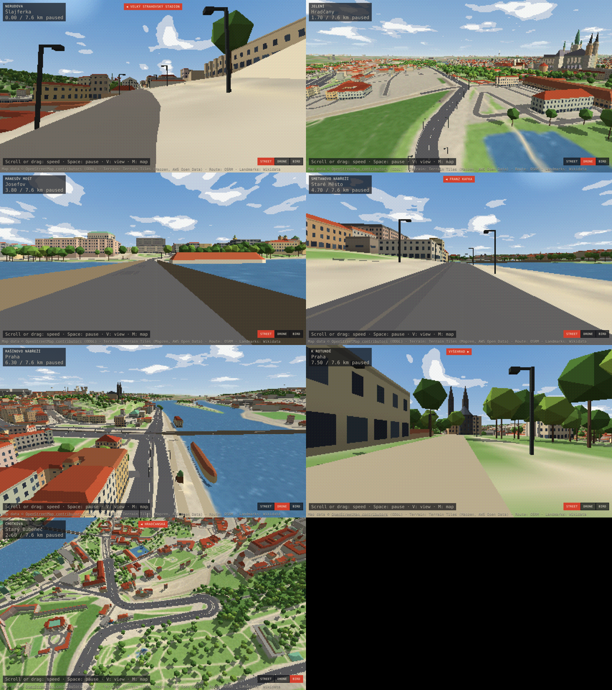

# Praha: Pixel Path

## Praha 3D (the recognisable one)

`trips/prague/3d/` is a pixel-art **3D** drive along the same route, built from the real city: 23 000 OpenStreetMap
buildings with their real heights, roof shapes, domes and spires; real terrain (castle hill, Petřín, Vyšehrad) and a
32 km horizon; the Vltava, parks, roads, tram tracks, bridges and 45 000 trees. No generated art. Street, drone and bird
views (V or 1/2/3), scroll or drag for speed, M for a map.

```
node tools/praha3d/terrain.mjs   # heights from Terrain Tiles
NODE_USE_ENV_PROXY=1 node tools/praha3d/osm.mjs   # OpenStreetMap via Overpass (slow; resumes)
node tools/praha3d/pack.mjs      # -> trips/prague/3d/*.bin, path.json
cp tools/praha3d/web/* trips/prague/3d/ && (cd trips/prague/3d && python3 -m http.server 8080)
```



## The 2D pixel-path version

A pixel-art fly-through of a real road in Prague, made with
[jonwheatley/pixel-path](https://github.com/jonwheatley/pixel-path) (MIT). The skill is copied into
`.claude/skills/pixel-path/` (upstream commit `74341a9`), so Claude Code picks it up in this repo.

**Route:** Prague Castle (Hradčanské náměstí) → Malá Strana → over the Vltava → along the embankment past the
Charles Bridge and the National Theatre → Vyšehrad. It's about 5–7 km and stays in one region ("historic Prague").

## Run it

```
./prague.sh route    # route + cost estimate (free)
./prague.sh bake     # OpenStreetMap buildings, land cover, hills, landmarks (free, a few minutes)
./prague.sh plan     # art plan + free placeholder art
./prague.sh view     # self-check, then serve on http://127.0.0.1:8080/
```

Or just ask Claude: *"make the Prague pixel path"*.

### Paid art (optional)
Placeholders are free. For real art, set `RETRODIFFUSION_API_KEY` in your own terminal or in the environment's
secrets (never paste it into a chat). Pick a level, `LEVEL=sparse|moderate|detailed ./prague.sh plan`, then:

```
node .claude/skills/pixel-path/scripts/rd.mjs quote --trip trips/prague
node .claude/skills/pixel-path/scripts/rd.mjs run   --trip trips/prague --budget 4.00
node .claude/skills/pixel-path/scripts/clean.mjs    --trip trips/prague
```

Rough cost for one region: sparse $0.72, moderate about $3.24, detailed about $6.48, plus about 25% for re-rolls.
After the bake, add Prague's landmarks (Prague Castle / St Vitus, the National Theatre, the Dancing House,
Vyšehrad's Basilica of St Peter and St Paul) to `plan` as `--subject "lm-<wikidata id>=..."`, using the IDs the bake
prints.

## Network
The bake needs these hosts: `nominatim.openstreetmap.org`, `router.project-osrm.org`, `routing.openstreetmap.de`,
`overpass-api.de` (and its mirrors `lz4.`/`z.overpass-api.de`, `overpass.kumi.systems`, `overpass.private.coffee`),
`s3.amazonaws.com`, `query.wikidata.org`/`www.wikidata.org`, plus `api.retrodiffusion.ai` for paid art.

## Credits
Map data © OpenStreetMap contributors (ODbL). Routing: OSRM. Elevation: Terrain Tiles (Mapzen/Tilezen, AWS).
Landmarks: Wikidata. Art: RetroDiffusion. Skill by Jon Wheatley (MIT).
